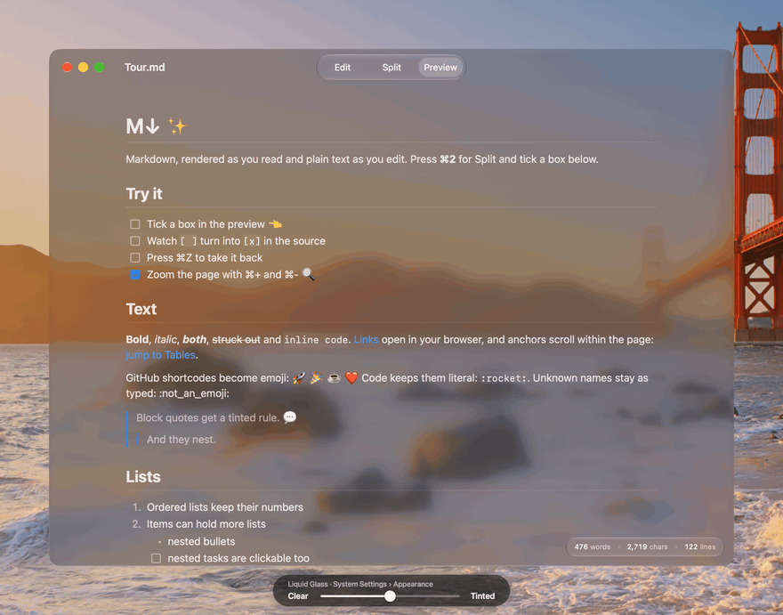

<p align="center">
  
</p>

<h1 align="center">M↓</h1>

<p align="center">
  <strong>Markdown, rendered as you read and plain text as you edit.</strong><br>
  A small, run-on-demand reader and editor for macOS 26 and later,<br>
  built with SwiftUI and Liquid Glass. No dependencies.
</p>

![Ticking task boxes in Split mode: each click flips the box's [ ] in the source](docs/checkbox-demo.gif)

The app is named for the mark on its icon. Spotlight can't take the arrow, so type **mdown** to
find it. Open [`Samples/Tour.md`](Samples/Tour.md) in it for a tour of everything below.

## What it does

- **Three views.** Edit, Split and Preview, on ⌘1, ⌘2 and ⌘3 or the toolbar. Markdown opens in
  Preview and plain text in Edit; Settings changes either.
- **Checkboxes you can tick.** Clicking a task box in the preview flips its `[ ]` or `[x]` in
  the source. It's an ordinary edit: the document shows as changed, the editor follows, and ⌘Z
  undoes it.
- **GitHub-style Markdown.** Headings with in-page anchors, nested lists and block quotes,
  tables with column alignment, images from the file's folder, and `:emoji:` shortcodes for 712
  GitHub names, left alone inside code.
- **Highlighted code.** Fenced blocks get a copy button and colors for comments, strings,
  numbers and keywords in Swift, Python, Ruby, JavaScript and TypeScript, JSON, shell, YAML,
  HTML and XML, CSS and SQL. Other languages get a generic pass; a fence with no language
  stays plain.
- **Liquid Glass.** The toolbar, the word-count pill and the copy buttons are the system's
  glass. An optional see-through background lets the desktop show through the whole window.
- **Quick Look.** With the optional extension, pressing Space on a `.md` file in Finder shows
  the same preview.
- **Run on demand.** Close the last window and the app quits, unless you turn that off.

## See-through glass

Turn on **Settings › Window › See-through glass background** and the window itself becomes
glass, with the desktop showing through behind the text. How clear or tinted it looks follows
**Liquid Glass** in System Settings › Appearance, the same setting that drives the toolbar and
the pill. It's off by default, because text is harder to read over a busy wallpaper.



## Build and install

Needs macOS 26 or later and Xcode 26 or later for the Swift 6 toolchain.

```bash
git clone https://github.com/StoneHub/mdown.git
cd mdown
Scripts/build.sh install
```

That builds the Swift package in release mode, assembles `build/M↓.app` with its generated
icon and an ad-hoc signature, copies it to `~/Applications/M↓.app`, and registers it with
Launch Services, and adds a Finder comment so Spotlight finds it as **mdown**. There is no Xcode
project; `swift build` is the whole toolchain.

| Command | Does |
|---|---|
| `Scripts/build.sh` | Builds `build/M↓.app` |
| `Scripts/build.sh install` | Builds, copies to `~/Applications` and registers it |
| `Scripts/build.sh run file.md` | Builds and opens a file |
| `Scripts/build.sh icon` | Regenerates the icon from `Scripts/make-icon.swift` |
| `Scripts/build.sh quicklook` | Builds with the Quick Look extension |

### Quick Look extension (optional)

```bash
brew install xcodegen
Scripts/build.sh quicklook && Scripts/build.sh install
```

App extensions need an Xcode target, so `project.yml` is an XcodeGen spec for that one target.
`quicklook` builds the app as usual, generates `MDown.xcodeproj` (gitignored), builds
`MDownQuickLook.appex` with `xcodebuild` (ad-hoc signed, sandboxed), embeds it under
`Contents/PlugIns` and re-signs the app. `install` then registers it with `pluginkit`, after
which Finder's Space-bar preview and `qlmanage -p file.md` render Markdown the way the app
does. A plain `Scripts/build.sh` keeps whatever extension is already in `build/M↓.app` and says
so.

### Make it the default for .md and .txt

**M↓ menu › Make M↓ the Default for Markdown & Text…**, or the same button in Settings.
It calls `NSWorkspace.setDefaultApplication` for `net.daringfireball.markdown` and
`public.plain-text`. The manual route: Finder › Get Info on a file › Open With › M↓ ›
Change All…

## Shortcuts

| Action | Keys |
|---|---|
| Edit / Split / Preview | ⌘1 / ⌘2 / ⌘3, or the toolbar segment |
| Zoom in / out / actual size | ⌘+ / ⌘- / ⌘0, in 10% steps from 60% to 200% |
| Find in the editor | ⌘F |
| New / Open / Save | ⌘N / ⌘O / ⌘S |
| Undo a tick or an edit | ⌘Z |
| Settings | ⌘, |

## Settings

| Setting | Default |
|---|---|
| Open Markdown in | Preview |
| Open plain text in | Edit |
| Quit when the last window closes | On |
| See-through glass background | Off |

The Finder section has the default-opener button.

## How it works

- `TextDocument` is a `FileDocument`; `DocumentGroup` provides open, save, autosave and undo.
  `String.decodingTextFile` reads UTF-8 first, sniffs other encodings and never refuses a file;
  saving always writes UTF-8.
- `EditorView` wraps `NSTextView`: the native find bar and undo, with smart quotes and dashes
  off.
- `MarkdownParser` uses Foundation's `AttributedString(markdown:)` in `.full` mode and walks
  the `presentationIntent` paths into a `MarkdownBlock` tree. Its inline pass bakes SwiftUI
  fonts into the runs and swaps emoji shortcodes; `SyntaxHighlighter` colors fenced code.
- Foundation reports no source positions, so each task item gets an index in document order.
  `MarkdownParser.togglingTask` finds the line with that index, skipping fenced code, and flips
  its box; `DocumentView` writes it through the document binding and registers the undo.
- `MarkdownPreview` renders the tree with SwiftUI `Text`, `Grid` and glass controls.
  `Typography` holds the point sizes and ratios. Rendering runs off the main actor and is
  debounced while you type in Split mode.
- `SplitPane` is a hand-rolled split, because `HSplitView` lays SwiftUI children out under the
  glass toolbar.
- `SeeThroughWindow` puts an `NSGlassEffectView` behind the window's content when the setting
  is on, and leaves the window alone when it's off.
- `AppDelegate.applicationShouldTerminateAfterLastWindowClosed` is consulted by
  `DocumentGroup` and backs the quit setting.
- `QuickLook/PreviewViewController` hosts `MarkdownPreview` for the Quick Look extension,
  sharing the `Markdown/` sources, `Typography` and the text decoder with the app.

## Not done yet

- A preview checkbox finds its line by counting list lines that start with a box. Markdown
  that Foundation reads differently from that count, such as an escaped `\[ ]` or a box inside an
  indented code block, can make a click flip the wrong box; ⌘Z puts it back.
- Images next to a Markdown file can't be read inside the Quick Look preview, because the
  extension's sandbox covers only the previewed file; the preview says "Can't read X here"
  instead.
- The Quick Look extension is only built by `Scripts/build.sh quicklook`; the package-only
  build can't produce an app extension.
