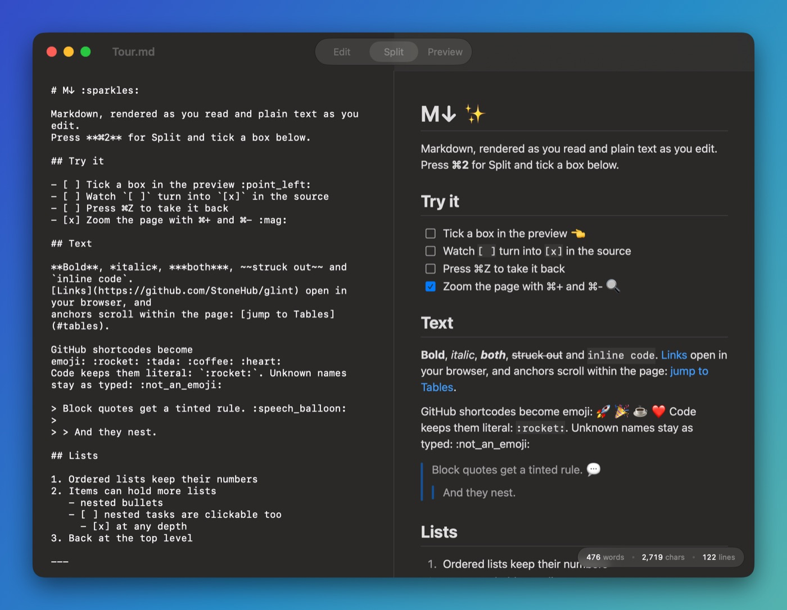

# M↓ :sparkles:

Markdown, rendered as you read and plain text as you edit.
Press **⌘2** for Split and tick a box below.

## Try it

- [ ] Tick a box in the preview :point_left:
- [ ] Watch `[ ]` turn into `[x]` in the source
- [ ] Press ⌘Z to take it back
- [x] Zoom the page with ⌘+ and ⌘- :mag:

## Text

**Bold**, *italic*, ***both***, ~~struck out~~ and `inline code`.
[Links](https://github.com/StoneHub/mdown) open in your browser, and
anchors scroll within the page: [jump to Tables](#tables).

GitHub shortcodes become emoji: :rocket: :tada: :coffee: :heart:
Code keeps them literal: `:rocket:`. Unknown names stay as typed: :not_an_emoji:

> Block quotes get a tinted rule. :speech_balloon:
>
> > And they nest.

## Lists

1. Ordered lists keep their numbers
2. Items can hold more lists
   - nested bullets
   - [ ] nested tasks are clickable too
     - [x] at any depth
3. Back at the top level

---

## Code

Fenced blocks get a copy button and highlighting for comments,
strings, numbers and keywords.

```swift
// Swift
struct Note: Identifiable {
    let id = UUID()
    var title = "Hello, \(name)"
    var stars: Int = 0x2A
}
```

```python
def fib(n: int) -> int:  # Python
    """The slow way."""
    return n if n < 2 else fib(n - 1) + fib(n - 2)
```

```ruby
class Greeter  # Ruby
  def hello(name = "world") = puts "Hi, #{name}!"
end
```

```ts
// TypeScript
const sum = (xs: number[]): number => xs.reduce((a, b) => a + b, 0);
```

```json
{ "app": "M↓", "version": 0.1, "dependencies": [], "beta": true, "team": null }
```

```bash
# Shell
Scripts/build.sh install && open -a "M↓" Samples/Tour.md
```

```yaml
name: M↓        # YAML
features:
  - preview
  - checkboxes: true
```

```sql
SELECT title, done FROM tasks WHERE done = FALSE ORDER BY title; -- SQL
```

```html
<!-- HTML -->
<p class="note">Hello, <em>there</em>.</p>
```

```css
@media (prefers-color-scheme: dark) { .note { color: #fff; } } /* CSS */
```

```
A fence with no language stays plain: x = 1 "two" // three
```

## Tables

| Shortcut       | Does                   | Works in |
|:---------------|:----------------------:|---------:|
| ⌘1 · ⌘2 · ⌘3   | Edit · Split · Preview |      all |
| ⌘+ · ⌘- · ⌘0   | Zoom in · out · reset  |      all |
| ⌘F             | Find                   |     Edit |
| ⌘Z             | Undo a tick            |    Split |
| Space          | Quick Look in Finder   |   Finder |

## Images

Images next to the file load from its folder.



## And

- Press Space on a `.md` in Finder for this same preview in Quick Look.
- **M↓ menu → Make M↓ the Default for Markdown & Text…** opens `.md` files here.
- Close the last window and the app quits. :wave:
